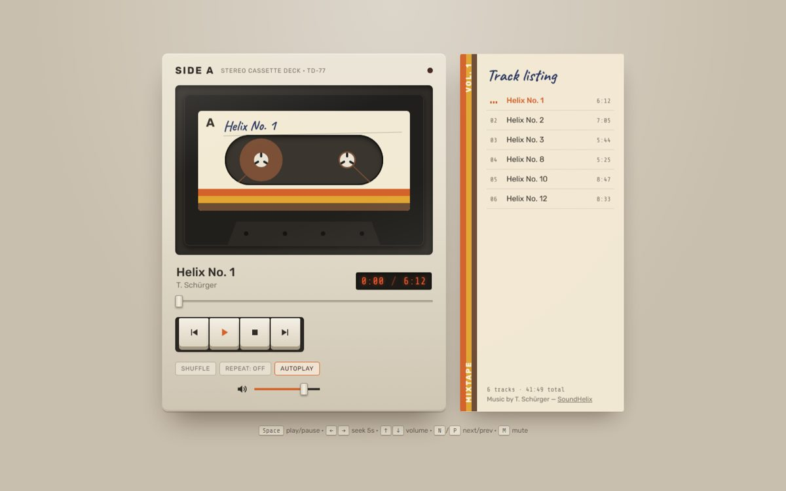

# Side A: Music Player

Task 4 of the CodeAlpha Frontend Development internship.

A music player designed like a 70s cassette deck. There's a tape in the window, and the brown tape slowly winds from the left reel to the right as the song plays. The play key stays pressed down while music is playing, and the playlist looks like the paper insert (J-card) from a cassette case.



## Features

**Required by the task:**

- play, pause, next and previous (plus stop)
- song title, artist, elapsed time and total duration
- a progress bar you can drag to seek
- volume slider and mute button

**Bonus:**

- **Playlist:** click any track to play it. The playing track shows small animated bars. The length of every song is read from the files themselves.
- **Autoplay:** the next track starts when one ends. You can turn this off.
- **Shuffle:** a proper Fisher–Yates shuffle, so every track plays once before any repeats
- **Repeat:** off, all, or one
- **Previous:** the first press restarts the current song if you're more than 3 seconds in. A second press goes to the previous track.

**Extras:**

- When you change tracks, the cassette ejects and a new one slides in with a different label colour.
- **Keyboard shortcuts:**

| Key | Action |
| --- | --- |
| `Space` | play / pause |
| `←` `→` | seek 5 seconds |
| `↑` `↓` | volume |
| `N` / `P` | next / previous |
| `M` | mute |
| `S` | shuffle |
| `R` | repeat mode |

- **Media keys and lock screen controls** through the Media Session API
- **Remembers** your volume, last track, shuffle, repeat and autoplay settings (`localStorage`)

## Running it

Open `index.html` in a browser. Some browsers restrict audio on `file://` pages, so if something doesn't play, run `npx serve .` (or use VS Code Live Server) and open the local URL instead.

## Folder structure

```
CodeAlpha_MusicPlayer/
├── index.html
├── style.css
├── script.js
├── music/          mp3 files
└── README.md
```

## Adding your own songs

Put the mp3 files in `music/` and edit the `tracks` array at the top of `script.js`:

```js
{ file: "music/my-song.mp3", title: "My Song", artist: "Someone", label: "#f3ead5" },
```

`label` sets the colour of the cassette label for that song.

## How the reels work

This was the most fun part.

On a real cassette the tape moves at a constant speed. As tape winds across, the left reel gets smaller and the right reel gets bigger. The total amount of tape stays the same, which means:

```
r_left² + r_right² = constant
```

From the song's progress `p` (0 to 1), each reel's radius is:

```js
r = Math.sqrt(rMin² + p * (rMax² - rMin²))
```

Both reels move the same length of tape each frame, so the turning angle for each one is `length / radius`. The smaller reel spins faster, just like on a real deck.

When you seek, the drawn progress eases toward the new position rather than jumping. The reels whizz round like fast-forward or rewind, and the spin speed is capped so it doesn't turn into a blur.

## Credits

Music: "SoundHelix Song" examples by T. Schürger, from [soundhelix.com](https://www.soundhelix.com). The track titles in the player are shortened names for these songs.

Fonts: Rubik, Caveat (the handwriting on the label) and Share Tech Mono (the time counter), from Google Fonts.
